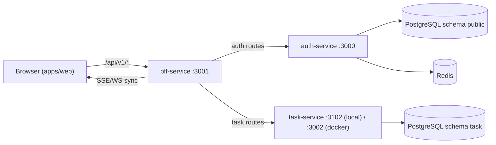
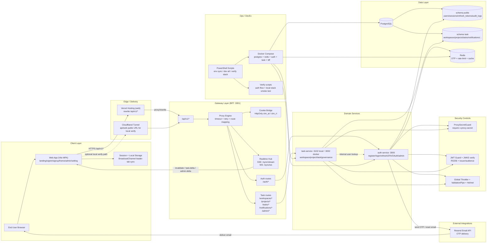
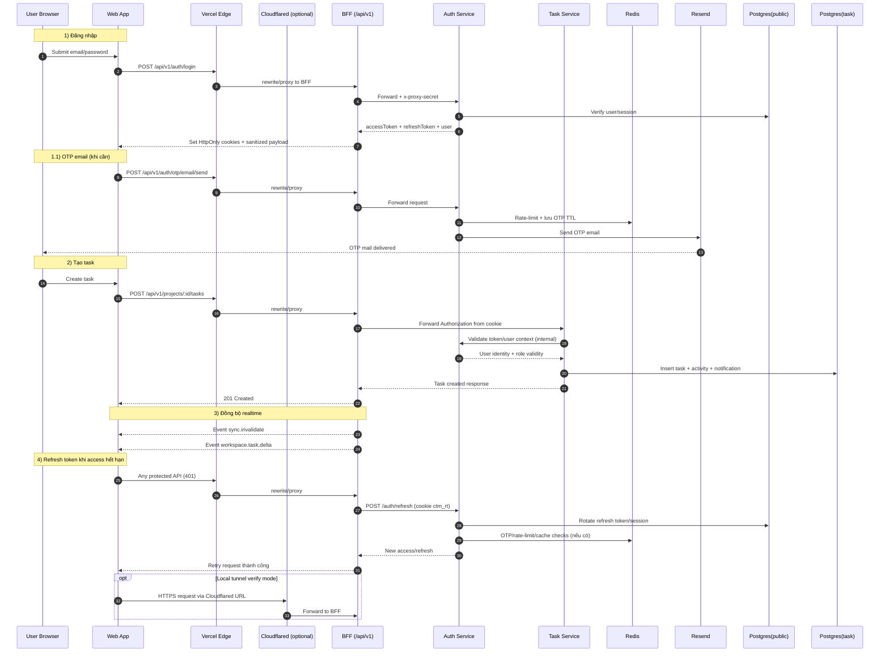

# PROJECT OVERVIEW

## 1. Thông tin nhanh

- **Tên dự án:** CTM (trong code có xuất hiện cả tên "Hello")
- **Loại dự án:** Full-stack task/collaboration platform (workspace/project/task) theo kiến trúc microservices + BFF
- **Mục tiêu:** cung cấp nền tảng quản lý công việc nhiều người dùng, có kiểm soát quyền, quản trị hệ thống, realtime sync, và sẵn sàng mở rộng
- **Snapshot phân tích:** 2026-04-04 (theo trạng thái hiện tại của working tree)

---

## 2. Executive Summary

CTM là hệ thống quản lý công việc theo mô hình cộng tác nhóm, tổ chức theo 4 lớp:

1. **Identity & Access:** xác thực, phiên đăng nhập, refresh token, 2FA, OAuth Google, OTP email.
2. **Collaboration:** workspace/project/task/comment/member.
3. **Governance:** activity, notification, saved views, templates, report, admin dashboard.
4. **Experience Layer:** frontend multi-page + BFF để chuẩn hóa API cho browser, cookie auth, realtime sync.

Điểm mạnh nổi bật:

- Kiến trúc tách lớp rõ (`web` -> `bff` -> `auth/task`)
- Bảo mật tốt ở lớp service (proxy secret guard, JWT JWKS verification, throttling, validation)
- Có realtime đồng bộ UI (SSE/WebSocket + cơ chế leader tab)
- Nghiệp vụ đã vượt mức MVP cơ bản (admin/security/report/template/search/notification)

---

## 3. Phạm vi chức năng hiện tại

## 3.1 Auth & Identity (`apps/auth-service`)

- Đăng ký/đăng nhập/đăng xuất/refresh/access session profile
- OTP email: gửi mã, xác thực mã, reset password bằng OTP
- 2FA TOTP: setup, confirm, verify login challenge, disable (OTP hoặc backup code)
- OAuth Google: start -> callback -> oauth exchange code
- Quản lý session người dùng: list/revoke/revoke others
- Quản trị hệ thống:
  - security dashboard
  - danh sách user + filter
  - update trạng thái user
  - update system role
  - xóa user
  - quản lý session của user
  - audit logs

## 3.2 Task & Collaboration (`apps/task-service`)

- Workspace: CRUD + settings
- Project: CRUD + settings + archive/restore
- Task: create/update/delete/move (board), create từ workspace hoặc project
- Comment theo task
- Membership theo email ở mức workspace/project, cập nhật role, remove member
- Board + Calendar view theo project/workspace
- Notifications: list, unread count, mark read, mark all read, stream
- Governance:
  - workspace/project activities
  - workspace search
  - saved views
  - project templates + create project from template
  - report overview/breakdown/export CSV
  - admin workspaces
  - internal admin endpoints (ownership check + cleanup user workspace data)

## 3.3 BFF & Gateway (`apps/bff-service`)

- Public API cho frontend tại `/api/v1/*`
- Proxy route theo domain (`auth`, `workspaces`, `projects`, `tasks`, `notifications`, `admin`, `saved-views`, `templates`)
- Retry/timeout/upstream error normalization
- Tự chuyển access/refresh token sang **HttpOnly cookies**
- Tự gắn `Authorization` từ cookie khi gọi upstream
- Realtime sync service:
  - SSE endpoint `/api/v1/sync/stream`
  - WS endpoint `/api/v1/sync/ws`
  - phát invalidate/task delta/admin delta cho client phù hợp scope

## 3.4 Frontend (`apps/web`)

- Vite multi-page app (landing/signin/signup/home/admin/setting/workspace-setting/about/auth-callback)
- Mô-đun hóa API theo domain (`auth`, `tasks`, `governance`, `profile`, `membership`, `workspace`)
- Flow OAuth callback + token exchange
- Notification widget + admin shortcut + workspace header hub
- Realtime sync có **leader election đa tab** để tránh mở nhiều stream dư thừa
- Admin page hỗ trợ dashboard bảo mật, user management, audit logs, report export

---

## 4. Kiến trúc hệ thống



## 4.1 Luồng request chuẩn

1. Frontend gọi `/api/v1/*`.
2. BFF xác định upstream và forward request.
3. BFF gắn `x-proxy-secret` để qua guard tại service backend.
4. Auth/Task xử lý nghiệp vụ + DB.
5. BFF nhận response:
   - với auth session endpoints: set cookie HttpOnly, ẩn token khỏi payload trả browser.
   - với mutation task/admin: phát event realtime invalidate/delta.

## 4.2 Boundary bảo mật

- Auth/Task không dành cho browser gọi trực tiếp (trừ health/JWKS public).
- `ProxySecretGuard` chặn request thiếu `x-proxy-secret`.
- Token người dùng được verify bằng JWKS RS256 + issuer/audience.
- Task guard có fallback cache ngắn hạn cho auth-me check để tăng resilience.

## 4.3 Mermaid mô tả cấu trúc hệ thống



## 4.4 Mermaid mô tả luồng request end-to-end



---

## 5. Mô hình dữ liệu

## 5.1 Auth schema (`public`)

Thực thể chính:

- `users` (bao gồm profile + systemRole + 2FA state)
- `sessions`
- `refresh_tokens`
- `audit_logs`
- `oauth_exchange_codes`

Enums nổi bật:

- `user_status`: ACTIVE/LOCKED/DISABLED
- `system_role`: SUPER_ADMIN/SYSTEM_ADMIN/USER
- `session_revoke_reason`
- `audit_action`

## 5.2 Task schema (`task`)

Thực thể chính:

- Collaboration core: `workspaces`, `workspace_settings`, `workspace_members`, `projects`, `project_settings`, `project_members`, `project_invitations`
- Task core: `columns`, `tasks`, `comments`, `labels`, `task_labels`
- Governance: `activities`, `notifications`, `saved_views`, `project_templates` + related tables
- Reliability: `idempotency_records`

Enums nổi bật:

- Role/collab: `workspace_role`, `membership_status`
- Lifecycle: `workspace_status`, `project_status`, `project_visibility`
- Task: `task_priority`, `task_status`
- Governance: `notification_type`, `saved_view_type`

---

## 6. Realtime và đồng bộ dữ liệu

- BFF sync service quản lý kết nối SSE + WebSocket.
- Event chính:
  - `sync.invalidate`
  - `workspace.task.delta`
  - `admin.event`
  - `admin.delta`
- Frontend chỉ cho 1 tab leader mở stream; các tab còn lại nhận broadcast channel nội bộ.
- Hỗ trợ scope admin (`scope=admin`) và workspace-scoped sync.

---

## 7. Công nghệ và stack

- **Backend:** NestJS 11, TypeScript, Prisma, Joi, Throttler, Helmet, cookie-parser
- **Auth security:** JWT RS256 + JWKS, argon2, otplib (TOTP), QRCode
- **Email OTP:** Resend
- **Cache/session support:** Redis (ioredis)
- **Frontend:** Vite 8, TypeScript, multi-page HTML/CSS/JS hybrid
- **Database:** PostgreSQL 16
- **Infra local:** Docker Compose
- **Scripts vận hành:** PowerShell

---

## 8. Cấu trúc repo

```text
E:\ctm
├─ apps
│  ├─ auth-service
│  ├─ task-service
│  ├─ bff-service
│  └─ web
├─ docker
│  └─ env
├─ scripts
├─ docker-compose.yml
├─ package.json
└─ README.md
```

---

## 9. Runbook vận hành local

## 9.1 Chuẩn bị môi trường

1. `npm run env:sync`
2. `npm run install:all`
3. `docker compose up -d postgres redis`
4. `npm run db:generate`
5. `npm run db:migrate`

## 9.2 Chạy hệ thống

- Chạy từng service:
  - `npm run dev:auth`
  - `npm run dev:task`
  - `npm run dev:bff`
  - `npm run dev:web`
- Hoặc all-in-one:
  - `npm run dev:all`
  - `npm run dev:all:stop`

## 9.3 Verify tự động

- `npm run verify:stack` (health + flow tạo workspace/project/task)
- `npm run verify:auth` (2FA + auth flow + oauth start)
- `npm run verify:local` (spin services + chạy verify tổng)

---

## 10. Triển khai và môi trường

## 10.1 Docker Compose hiện có

- `postgres`, `redis`, `auth-service`, `task-service`, `bff-service`
- Healthcheck đầy đủ cho từng service
- Volume persistence cho DB/Redis

## 10.2 Frontend deployment

- `apps/web/vercel.json` rewrite `/api/v1/*` về API domain production
- Có hỗ trợ môi trường preview Vercel trong CORS BFF

## 10.3 Tunnel hỗ trợ kiểm thử OAuth

- Script `configure-cloudflared-env.ps1` + `sync-local-env.ps1`
- Dùng được cho test redirect OAuth trong môi trường public URL

---

## 11. Chất lượng mã nguồn và kiểm thử

- Có unit/integration spec ở cả backend/frontend modules
- Có e2e test scaffold (`test/` ở auth/task)
- Có script verify nghiệp vụ quan trọng chạy được ở local
- Hệ thống logging có request-id và interceptor global

---

## 12. Rủi ro và lưu ý quan trọng khi trình bày

1. **Repo đang ở trạng thái phát triển dở (dirty working tree, nhiều file modified/untracked).**
2. **Một số tài liệu có thể chưa theo kịp code mới** (ví dụ README cũ chưa phản ánh đầy đủ OTP/refresh/admin/realtime hiện tại).
3. **Có điểm không đồng nhất cổng task-service**:
   - local env/example dùng `3102`
   - docker service expose `3002`
4. **Default DB URL trong env validation có chỗ dùng port 5433**, trong khi `.env.example` và script local mặc định 5432.
5. **Có thông tin nhạy cảm xuất hiện trong file env docker hiện tại** (ví dụ API key) -> cần chuyển về secret manager và rotate key trước khi public repo.
6. **Naming chưa thống nhất** giữa "CTM" và "Hello" trong các module/env/docs.

---

## 13. Điểm mạnh để dùng khi demo/pitch

- Kiến trúc production-like, tách domain rõ, không monolith thuần.
- Security stack đầy đủ cho sản phẩm SaaS thực tế (JWT key rotation-ready, 2FA, session control, admin governance).
- Realtime sync có chiến lược đa-tab rõ ràng.
- Nghiệp vụ đã bao phủ nhiều lớp hơn task app thông thường (saved views, templates, reports, audit/admin).
- Có script vận hành/verify giúp onboarding team nhanh.

---

## 14. Kịch bản demo đề xuất (10-15 phút)

1. Đăng ký user + đăng nhập qua BFF.
2. Tạo workspace/project/task, thao tác move task trên board.
3. Bật 2FA, logout/login lại để thấy challenge flow.
4. Mở admin page với tài khoản system admin:
   - xem security dashboard
   - cập nhật status/role user
   - xem audit logs
5. Trigger thay đổi task để minh họa notification/realtime invalidate.
6. Export report CSV từ workspace.

---

## 15. Định hướng nâng cấp ngắn hạn

1. Chuẩn hóa tài liệu theo code hiện tại (README + API contract).
2. Chuẩn hóa port/environment defaults.
3. Di chuyển toàn bộ secret sang vault/platform env.
4. Chốt naming thống nhất (CTM vs Hello).
5. Tăng độ phủ test regression cho auth refresh/OAuth/admin cleanup/realtime.
